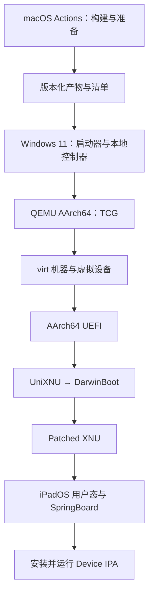
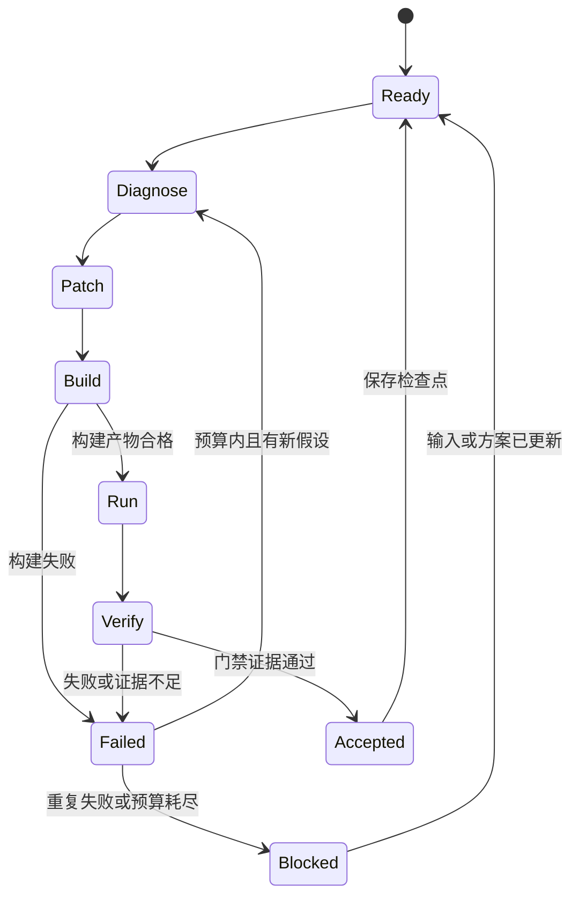

# UniPad PRD v0.1

**项目：在 Intel Windows 上运行真实 iPadOS 与 ARM64 Device IPA**  
**编写日期：2026-10-22（北京时间）**  
**状态：PRD 草案；尚未在目标电脑构建或运行验证**  
**用户设备：Windows 11 + Intel i5 + RTX 3060 笔记本；CPU 具体型号、内存与剩余磁盘待盘点**  
**研发方式：Windows 本地 AI 执行闭环，GitHub Actions macOS 承担需要 Apple 工具的构建**

## 1. 产品目标与立项判断

在用户现有 Windows 笔记本上，基于 UniXNU 与社区 UniXNU-qemu 设备仓库，通过 QEMU AArch64 系统模拟启动真实 iPadOS 用户态，进入 SpringBoard，并安装、启动、交互运行选定的无 DRM ARM64 Device IPA。

最终运行和验收必须发生在这台 Intel Windows 电脑上。macOS 可以参与构建、镜像准备和对照实验；云端运行 iPadOS 后向 Windows 串流，不构成本项目达标。

**立项判断：已有值得复用的上游起点，但 Windows 实现及 IPA 链路仍须实验证明。** 本 PRD 不把“上游演示成功”“QEMU 支持 ARM64”推导为“本机一定成功”，也不承诺任意 IPA、商用流畅度或全自动 AI 研发必然完成。

项目分三层交付：

| 层级 | 要交付的结果 | 何时算成功 |
| --- | --- | --- |
| 启动原型 | Windows 本地启动 iPadOS，进入可操作的 SpringBoard | 本机冷启动证据、真实进程证据、输入产生可见响应 |
| IPA MVP，第一版正式目标 | 导入独立的 Device IPA，安装、启动、交互并保存数据 | 完成第 5 节全部验收，正常关机重启后仍可使用 |
| 扩展版本 | 网络、更多应用、音频、图形加速与易用安装包 | 每项有单独兼容性记录，不以 MVP 代替验证 |

## 2. 证据基线与需要修正的前提

### 2.1 本轮实际核查的内容

核查了项目公开文档、社区仓库 README、`board.toml`、`unixnu.lock` 及 QEMU、GitHub、Apple 官方文档。没有在用户电脑复现，也没有完成所有脚本源码审计。网页状态随上游更新，工程启动时必须固定实际提交版本。

| 编号 | 已查到的信息 | 证据等级 | 对本 PRD 的影响 |
| --- | --- | --- | --- |
| E01 | UniXNU 面向 UEFI 下的非 Apple ARM64 平台，设备适配与公共模块分离。[S1] | 上游文档 | 复用公共框架，保留 Windows/QEMU 的独立适配层 |
| E02 | 社区 UniXNU-qemu 作者报告 iPadOS 主屏幕、触控/Home、Mac GPU Metal 桥接；文字键盘仍未完成。[S2] | 作者自述，未独立复现 | 不能沿用“完全没有输入和 Metal”的旧结论，也不能视为 Windows 已支持 |
| E03 | 同一仓库报告 Data 使用 RAM disk；软件图形路径存在设置白屏，Safari 还缺 AppOS。[S2] | 作者自述，未独立复现 | 持久化、图形和应用依赖分别验收 |
| E04 | 板级配置指向 iPad7,1、iPadOS 17.7.11、build 21H461。[S3] | 配置文件 | 将这组版本作为初始候选，不随意升级系统 |
| E05 | TCG 提供跨 CPU 架构模拟能力，支持 AArch64 系统模式。[S5] | QEMU 官方文档 | Intel 主机选择 TCG；实际系统兼容性仍由门禁确认 |
| E06 | UniXNU 的部分构建依赖 Xcode 与 macOS 磁盘工具，并有 macOS Actions 流程。[S6] | 上游构建文档 | 用户无需把本地开发主机改成 Mac |
| E07 | QEMU 的 VirtIO GPU 提供多种显示/加速后端，相关后端有各自的宿主与客体要求。[S7] | QEMU 官方文档 | 不能把加入 VirtIO GPU 参数当成 iPadOS 已获得 Metal |
| E08 | Apple 区分设备与 Simulator 构建目标；Simulator 也可包含 ARM64。[S10] | Apple 官方文档 | 不能仅凭 ARM64 架构判断测试 IPA 属于真机平台 |

E02、E03 的原始说明包含实验条件和未完成项，以上不是对其稳定性或完整兼容性的背书。

### 2.2 固定的技术判断

1. Intel 的 VT-x/Hyper-V 不会直接执行 ARM64 iPadOS 指令。本机选用 QEMU TCG；其速度必须实测，不能套用 Apple Silicon HVF 成绩。
2. 上游的 Mac Metal 方案依赖宿主 Metal。将其迁往 Windows Vulkan，涉及 API、资源、同步、着色器与显示适配；RTX 3060 只是可用硬件条件，不代表这些软件已存在。
3. 无 DRM、包含 ARM64、签名合规于某一安装方式，是不同条件。IPA 是否能安装和运行，还需验证信任策略、系统版本、动态库、权限与图形依赖。
4. 第一版先选 Wi-Fi 型虚拟 iPad 的能力范围。不能据此假定系统身份、密钥服务和平台服务可以全部省略。
5. 借鉴 Android 的设备抽象、主客体协议、日志和镜像管理。Android 驱动或图形栈不能直接移植成 iPadOS 驱动。

### 2.3 待验证假设

| 假设 | 最小验证 | 不成立时的处理 |
| --- | --- | --- |
| H01：当前 UniXNU-qemu 可在目标 Windows TCG 下启动 | 固定版本后走通 UEFI、XNU、用户态、桌面 | 定位 Windows、TCG 或客体问题；最终设备目标不变 |
| H02：软件图形路径足够支持首个 UIKit App | 显示真实 App 窗口、按钮和动态文字 | 最小图形兼容工作提升为 P0；仍无法实现则标记阻塞 |
| H03：客体可接受自有测试 App 的安装和执行 | 同一 IPA 经真实安装、注册和信任链进入 SpringBoard | 单独研究自有代码签名/信任与安装服务，不把复制文件视为完成 |
| H04：可提供重启后保留的 Data | 写入随机标记，正常关机，重新创建 QEMU 进程后读取 | 实现持久 Data 路线，再进入正式 IPA 验收 |
| H05：宿主资源和 TCG 性能满足基本交互 | 本机时间、内存、交互延迟和稳定性测量 | 优化瓶颈并记录结果；不能用远程 Mac 替代验收 |
| H06：Step 服务能通过所选执行器稳定工作 | 最小读文件、改临时文件、执行命令与故障恢复测试 | 增加兼容适配或调整执行器连接；不先假定 API 格式兼容 |

## 3. 第一版范围

### 3.1 P0：IPA MVP 必须完成

| ID | 需求 | 验收要点 |
| --- | --- | --- |
| FR01 | 固定系统、代码、工具与镜像版本 | 可从版本清单重建；所有运行文件有来源和哈希 |
| FR02 | Windows 原生 QEMU AArch64 TCG 启动 | 记录本机硬件、QEMU 路径、版本、实际命令和加速器 |
| FR03 | 真正的 iPadOS 用户态与 SpringBoard | 客体进程和屏幕变化能相互印证 |
| FR04 | 显示、单点触摸、Home、基础文字输入 | 鼠标操作与键盘/屏幕键盘输入能驱动真实客体界面 |
| FR05 | 持久 Data | 应用安装与应用数据在正常关机重启后保留 |
| FR06 | 运行时导入 IPA | 桌面启动后选择新 IPA，完成检查、传输、安装、注册和状态反馈 |
| FR07 | 真实应用运行 | 启动已安装 App，显示窗口并完成交互 |
| FR08 | 开始、停止和运行状态 | 正确反映启动中、已启动、失败、停止；不靠固定倒计时宣告成功 |
| FR09 | 日志与故障包 | 每次运行可关联到代码、产物、配置和实测结果 |
| FR10 | 可回到已知可启动版本 | 使用经过校验的历史产物和磁盘副本恢复 |

FR04 的文字输入可先使用客体屏幕键盘；如果不可用，则需补齐实际文字输入。MVP 不要求中文输入法、组合键和多点触控。

FR06 在研发早期可以使用命令行；应用预装到镜像仅用于诊断，不能替代正式运行时导入验收。导入新 App 不应要求重新编译 XNU 或重新生成整套系统镜像。

### 3.2 P1：MVP 后推进

- 通过 VirtIO Net 等路线联网，优先出站网络和自控 HTTPS 服务。
- 更多自有或获授权的 IPA 兼容性测试。
- 应用卸载、更新、安装历史和清晰的错误分类。
- 旋转、可选分辨率、音频和安装包体验。
- 真正经过验证的快照/恢复；必须说明保存的是磁盘还是整机状态。
- 简洁的 Windows 启动器：开始、停止、导入 IPA、查看日志、恢复。

### 3.3 P2：研究功能

- Windows Vulkan 图形桥接与 RTX 3060 加速。
- Metal 示例 App、复杂 UIKit/Core Animation 工作负载。
- 摄像头、定位、蓝牙等虚拟设备；按具体需求立项。

**优先级例外：** 如果首个 UIKit App 因缺少必要图形能力而无法显示，最小可用图形路径属于 P0 阻塞。完整 Metal 支持、GPU 性能优化仍属于后续范围。

### 3.4 第一版不作出的承诺

任意 App Store IPA、FairPlay 内容、Apple ID 服务、推送、Apple Pay、Face ID、真实 SEP、蜂窝通话、反作弊/设备认证应用和大型游戏均不属于第一版验收。不得通过系统修改对外宣称已获得等同真实 Apple 设备的安全性或兼容性。

## 4. 产品与运行架构



UniXNU 是引导管理组件，DarwinBoot 负责向 XNU 交接。开发文档需明确各层入口，避免把它们混作同一阶段。实际细节以固定版本的启动协议为准。[S11]

### 4.1 组件职责

| 组件 | 职责 | 初始选择 |
| --- | --- | --- |
| Windows 本地控制器 | 调度构建、下载校验、启动 QEMU、收集证据、保存状态 | Python 为主要逻辑，PowerShell 为 Windows 入口 |
| QEMU | CPU、内存、板级设备、显示与控制端口 | 原生 Windows 构建，显式 TCG |
| 固件/引导 | UEFI、UniXNU、DarwinBoot | 优先复用设备仓库对应输出 |
| 客体内核与设备支持 | 存储、显示、输入及后续网络 | 优先复用已验证模块，逐项适配 |
| 镜像管理 | 只读系统、可写 Data、备份和恢复 | 系统与用户数据分离；写入策略通过 H04 决定 |
| IPA 适配层 | 包检查、客体传输、安装/注册、执行状态 | 接口先固定，具体客体安装通道由实验选择 |
| macOS 构建 | XNU、Apple SDK 相关产物、需要 macOS 的磁盘准备 | GitHub 托管标准 runner |
| 可选 WSL2 | 工具转换、源码分析、辅助脚本 | 不作为最终运行必需项 |
| 可选 Ubuntu 2C2G | 外部任务监控 | 不进入关键路径 |

### 4.2 虚拟设备策略

| 能力 | 优先路线 | 前置验证 |
| --- | --- | --- |
| CPU | 跟随候选板级 CPU 模型与 TCG 配置 | 指令能力、异常级别、时钟、中断和页表是否匹配 |
| 固件显示 | 复用 ramfb/GOP 路径 | 像素格式、stride、分辨率与客体映射一致 |
| 系统存储 | 复用 VirtIO Block 根卷路线 | 挂载对象、UUID、验证策略和只读属性正确 |
| Data | 独立的持久写入方案 | 客体正常写入、同步、重启与恢复均可靠 |
| 输入 | 复用 VirtIO tablet/Home，再补文字 | 坐标缩放、拖动、释放事件与实际文字输入 |
| 控制 | QMP 及必要的调试接口 | Windows transport 可用，控制与串口互不抢占 |
| 网络 | VirtIO Net 或经验证的替代 | 客体驱动、IP、DNS 与 HTTPS 逐级成立 |
| GPU | 软件路径先验；必要时最小桥接 | 客体前端、协议、宿主后端、着色器、同步及呈现全部验证 |

Windows 不能沿用 Cocoa 显示或直接假定 POSIX socket、raw device、`/dev/*`、软链接、`hdiutil` 等行为可用。M0 需逐项盘点；这些是审计清单，不表示已确认每个脚本都包含这些依赖。

### 4.3 Windows GPU 的独立研究路线

可评估两类候选：复用客体 Metal 桥接、另做 Windows 宿主后端；或实现适合客体的 VirtIO GPU/图形协议支持。两者均须先证明最小渲染样例。

研究范围至少包括资源生命周期、缓冲区/纹理、着色器输入到宿主可执行形式、命令提交、同步、IOSurface/显示互通和错误处理。不能用“Metal → Vulkan”一行文字代替这些工作，也不把窗口显示使用 GPU 当成客体 Metal 加速。

## 5. 最终验收：证明能运行 IPA

### 5.1 测试样本

| 样本 | 构建约束 | 行为 |
| --- | --- | --- |
| HelloUniPad.ipa | 自有源码；iOS Device 平台；含 ARM64；部署版本兼容所选系统；无 DRM；最少权限 | 显示项目名、当次随机挑战值、按钮和点击计数 |
| UniPadNotes.ipa | 同上；新增本地持久化，不依赖联网 | 输入测试文本，保存到应用容器，重启后恢复 |

可先用 Objective-C/UIKit 减少额外运行时变量。签名、嵌入框架、权限和所采用的客体信任方式必须被记录。不能把未签名包、普通开发签名包、客体所有者信任包混为同一支持类别。

从 IPA 中检查 `Payload/*.app`、Info.plist、主可执行文件、Mach-O CPU slice、平台标识、最低系统版本、动态库及加密信息。只看后缀或 CPU 架构不足以通过检查。

### 5.2 端到端用例

1. 在用户 Windows 本机启动一个全新的 QEMU 进程；保留实际配置与版本证据。
2. 进入真实 SpringBoard，通过鼠标操作改变客体界面。
3. 在桌面启动后导入 HelloUniPad.ipa，记录输入包 SHA-256；先证明它此前未安装。
4. 完成包检查、传输、安装、注册。SpringBoard 出现真实图标，同时获得安装结果与 bundle ID。
5. 点击图标启动；获得对应进程或等效可信运行证据，并显示本次挑战值。
6. 连续点击按钮 10 次，画面计数正确变化。退出回主屏幕后能再次打开。
7. 导入 UniPadNotes.ipa，输入本次生成的字符串并保存；关闭重开 App 后可读。
8. 正常关机，结束 QEMU 进程，再从磁盘启动新进程；两款 App 和保存的字符串仍存在。
9. 重复冷启动流程三次，保存耗时和结果；测试失败时保留证据，不覆盖上次失败。
10. 导入一个不支持的平台包，返回明确原因；已有可用系统和应用保持可恢复。

第一版仅要求正常关机的数据持久化；断电一致性和崩溃后恢复作为额外指标，不能用“完整内存快照恢复”替代本节正常重启验证。

### 5.3 性能与稳定性

下列数值是**初始产品目标，不是已测能力**。本机首轮基线完成后，可据实修订性能目标；功能验收不得因此删除。

| 指标 | 初始目标 | 测量方式 |
| --- | --- | --- |
| 冷启动到可操作桌面 | 不超过 30 分钟 | QEMU 进程开始至真实点击有响应；报告 3 次结果 |
| Hello App 首次启动 | 不超过 120 秒 | 发出启动动作至首个可交互帧 |
| Hello App 点击响应 | 20 次交互的 p95 不超过 2 秒 | 宿主发送事件至对应帧改变，保留时间戳 |
| 稳定性 | 连续 30 分钟、50 次操作无客体 panic/宿主崩溃 | 串口、进程/诊断及屏幕证据联合确认 |
| 数据持久化 | 正常关机重启 3 次均保留 | 每次使用新随机标记，核对内容 |
| 可复现性 | 清洁工作目录重新构建和运行一次 | 输入版本、产物哈希和结果均可关联 |

UI 帧率、宿主内存峰值、CPU 占用、温度/降频和磁盘大小需要测量，但在硬件盘点之前不虚设有保证的数值。

## 6. 阶段、依赖与门禁

保留原讨论中的 M0–M15 名称，并增加 M9a/M9b/M10a，避免遗漏图形、持久化和输入。编号表示能力，不要求机械按数字依次研发；输入必须先于交互验收完成。

| 阶段 | 目标 | 通过证据 | 不足以通过的情况 |
| --- | --- | --- | --- |
| M0 | 依赖盘点与构建成立 | 固定提交、工具、配置；清洁构建产物及哈希；AI 接口冒烟测试 | README 可读、脚本返回 0、仅下载二进制 |
| M1 | Windows TCG 启动 UEFI | 固件日志与实际客体显示；QEMU 配置证据 | 只运行出 QEMU 窗口 |
| M2 | UniXNU 运行 | 配置读取、引导项与加载证据 | 仅出现静态图片 |
| M3 | DarwinBoot 完成交接准备 | 输入验证、加载信息和交接位置可追踪 | 仅打印组件名称 |
| M4 | XNU 进入并初始化关键底层 | 可定位内核执行、页表/异常/中断状态；失败能取证 | 单行 kernel banner |
| M5 | IOKit/平台层可用 | 必要服务匹配与驱动探测证据 | 无法说明设备是否真正工作 |
| M6 | VirtIO Block 可读 | 已知内容读取和校验正确 | 只枚举设备 |
| M7 | 正确 RootFS/SystemOS 可用 | 卷身份、挂载关系、dyld cache 读取证据 | 只启动 mockfs 测试进程 |
| M8 | 原始用户态 launchd 运行 | 原始 launchd 与后续守护进程证据 | 将 mockfs 中 PID 1 测试程序当成系统 launchd |
| M9 | SpringBoard 可操作 | 本机画面、进程及交互一致 | 只展示主屏幕截图 |
| M9a | 软件/最小图形路径满足 UIKit | 测试 App 的首帧、更新和输入反馈正确 | 只显示桌面壁纸 |
| M9b | Data 持久化 | 写入、正常关机、全新 QEMU 进程重启读取 | 仅 RAM disk 内有效 |
| M10 | IPA 安装 | 新包的安装、信任、注册、图标与记录 | 仅解压或复制 `.app` |
| M10a | IPA 接受和执行策略明确 | 自有包签名/信任方式、权限、失败原因可追踪 | 假定无 DRM 就一定允许执行 |
| M11 | IPA 启动 | dyld/进程、App 窗口、挑战值一致 | 进程瞬间存在但随后崩溃 |
| M12 | 输入与应用交互 | 点击、拖动、Home、文本用例通过 | 宿主窗口收到按键但客体无响应 |
| M13 | 网络 | 自控 HTTP/HTTPS 请求、DNS/TLS 可诊断 | 只见网卡或 link up |
| M14 | Windows GPU 路径 | 客体命令到 3060 的真实执行、图像正确性和性能证据 | 只见 RTX 使用率上升 |
| M15 | Metal IPA | 选定自有 Metal App 渲染并交互 | 仅枚举出 Metal device |

IPA MVP 的发布门禁包含 M0–M12 及附加关卡；M13–M15 不默认阻挡首版，除非已成为某个 P0 功能的实际依赖。

### 6.1 M0→M4 的首批工作包

| 工作包 | 范围 | 交付物 |
| --- | --- | --- |
| WP00：基线冻结 | 盘点 CPU/RAM/磁盘；获取候选仓库和锁文件；审计上游 AGENTS/贡献约定 | `host-inventory.json`、`sources.lock.json`、差异清单 |
| WP01：干净构建 | 先原样构建设备仓库最小配置；记录 bootstrap、ABI 与缓存前提 | 构建日志、工具版本、产物清单；失败时保留最小复现 |
| WP02：Windows UEFI | 使用与候选版本匹配的固件和最小设备组合 | M1 运行目录、串口、控制端口与截图 |
| WP03：引导交接 | 跑通 UniXNU 与 DarwinBoot，不同时加入 IPA/GPU 工作 | M2/M3 证据、实际地址与配置 |
| WP04：内核进入 | 固定 TCG CPU、GIC、时钟、内存与页配置；定位首次真实阻塞 | M4 证据或可复现 panic、下一条实验假设 |

能复用的上游关卡直接做本机验证，不为凑里程碑重新开发。不假定 M4 前所有问题都是 Windows 问题，需分开检查构建输入、模拟器与客体。

## 7. AI 自动研发闭环

### 7.1 角色与执行约束

Step-5-preview 作为候选推理/代码模型，Claude Code 作为候选工作执行环境。具体 API、模型标识、上下文、工具调用和长期会话能力在 M0 实测，不以名称推断兼容性。

第一版使用一个持久化控制器串行管理实验。每次只推进一个有证据的阻塞点；核心流程不能依赖模型记忆。自动化目标是无人值守地开展有边界实验，而不是无限修改直到模型自称完成。

### 7.2 状态机



实验失败时保留修改和日志，下一次从已知基线创建隔离分支/工作目录。运行版本指针和磁盘恢复与源码分支管理分离，避免直接覆盖用户工作目录。

### 7.3 每次实验必须记录

```json
{
  "schema_version": 1,
  "experiment_id": "exp-<unique-id>",
  "milestone": "M4",
  "status": "planned",
  "base_commit": "<resolved-sha>",
  "candidate_commit": null,
  "hypothesis": "<one falsifiable hypothesis>",
  "changes": [],
  "source_lock_sha256": "<sha256>",
  "build": {"run_id": null, "artifact_manifest_sha256": null},
  "runtime": {"host_inventory": null, "qemu_version": null, "accel": "tcg"},
  "evidence": [],
  "result": null,
  "next_action": null
}
```

这是拟定的记录格式，不是已有系统输出。应另存机器可读的阶段状态、最后成功版本、实验预算与磁盘副本标识。

### 7.4 验证器的要求

- 串口文本用于定位，不单独证明阶段成功；必要时结合 QMP、进程、内存诊断和随机挑战响应。
- 上游说明内核日志可能不直接输出到串口，因此采集器必须支持该版本可用的客体日志读取途径。[S2]
- 模型提交门禁证据，验证器依据固定条件判定；验证逻辑的修改独立记录，不能随功能修改偷偷放宽。
- 构建产物存在、尺寸非零、哈希/架构/清单正确后才进入运行；下载失败不能继续使用未标记的旧包。
- 调试运行和正式计时分开。断点暂停、观察工具延迟、宿主挂起不能混入正常性能结果。
- 每个实验设运行超时，并保留最后日志；没有进展也没有足够证据时标记 `blocked`，不能标记成功。

### 7.5 实验预算与恢复

初始建议每个假设最多 3 次受控实验；相同失败签名连续 3 次且没有新增证据时停止该路径。可以创建新的有依据假设，不能靠改名绕过限制。

预算按真实 Actions 用量、模型用量和本地运行时间累计，跨会话保留。缺少预算配置时，付费构建与模型无限循环不得默认启用。可继续做已获授权且不新增付费的本地诊断。

## 8. GitHub Actions 与 Windows 分工

### 8.1 macOS 构建输入与输出契约

| 类别 | 必需内容 |
| --- | --- |
| 输入 | UniXNU 提交、设备仓库提交、子模块/feeds 锁文件、defconfig、系统身份、构建模式、内核参数 |
| 工具信息 | runner 镜像版本、架构、Xcode/SDK/Clang/Python/QEMU 版本 |
| 平台信息 | 明确 payload 面向 TCG 还是 HVF；时钟、CPU、设备布局与其一致 |
| 构建产物 | 实际生成的固件/引导/内核/设备树及允许交付的辅助文件；逐项哈希 |
| 报告 | 构建日志、机器可读阶段结果、依赖缺失和未运行的步骤 |
| 镜像准备 | 单独任务处理必须依赖 macOS 的步骤，不将其混入每次内核小修改 |

优先复用上游现有 workflow；先验证它能否完整覆盖 QEMU 设备仓库的额外准备与 bootstrap，再决定是否扩展。不能把“有 macOS build”当成 QEMU 完整 RootFS 链路已经自动化。

### 8.2 拟定的流水线

1. `preflight`：验证输入、锁文件、空间和工具版本。
2. `build-macos`：按固定版本运行最小构建；只执行所需阶段。
3. `verify-artifacts`：校验输出、架构、配置、哈希和依赖清单。
4. `publish-build-artifacts`：上传明确允许的文件；默认不上传完整系统镜像与个人 Data。
5. Windows 本地通过 run ID 下载对应产物、核验并运行测试。
6. Windows 写入实验结果；只有门禁通过才更新本地可启动版本指针。

Windows 可主动轮询 GitHub 构建，无需把私人电脑暴露为公共仓库的自动执行节点。后续如采用 self-hosted runner，需单独定义受信任任务来源和适用范围。

### 8.3 工作流需求

- `workflow_dispatch` 起步，参数包含实验 ID、固定版本、配置与阶段。
- runner label 和 Xcode 版本在 M0 验证后固定；不假定 `macos-latest` 永远具有相同架构。
- 即使 runner 为 ARM64，也不默认存在所需 HVF 嵌套虚拟化条件。构建必须独立成立，对照运行另设能力探测。
- 禁止把 HVF payload 当成 TCG payload 下载到本机直接使用。
- 同一实验并发去重；设置 job 超时和 artifact 保留期；每次记录构建耗时。
- Actions、源仓库和源码依赖的外部访问权限最小化；密钥不进入日志或产物。
- 缓存键包含源码、配置和工具版本。签名密钥/策略不匹配时不得复用产物。

### 8.4 成本基线

截至核查日，GitHub 文档说明公开仓库使用标准托管 runner 的运行用量免费；私有仓库受账户额度及超额计费约束。[S8] 标准 macOS 的当前列示超额单价为 **0.062 美元/分钟**；larger runner 单独计费，不能套用公开标准 runner 的免费条件。[S9]

仅作超额运行费估算：30 分钟约 1.86 美元，60 分钟约 3.72 美元；100 次各 30 分钟约 186 美元。这里尚未计入模型、存储或其他费用，也没有假定用户账户套餐。

工程措施：优先小产物、复用缓存、失败快速退出；首次开通时确认账户预算。不要把旧的 macOS 价格或额度折算规则直接写死。实际账单以当期账户页面为准。

## 9. 目录与接口设计

本节是**拟建结构**，没有在本轮创建或初始化工程仓库。

| 路径 | 内容与原则 |
| --- | --- |
| `docs/PRD.md` | 本文及需求变更记录 |
| `docs/decisions/` | 版本、持久 Data、安装通道、图形路线等决策 |
| `config/sources.lock.json` | 核心/设备仓库、子模块、feeds、镜像和工具固定版本 |
| `config/machine.json` | CPU、内存、设备布局、时钟、显示等机器配置 |
| `config/budget.json` | 构建/模型/实验上限，默认不允许无限付费循环 |
| `src/controller/` | 实验与运行状态机 |
| `src/host/` | Windows QEMU、QMP、日志、镜像和输入适配 |
| `src/guest/` | 必要客体适配与安装辅助组件 |
| `scripts/windows/` | PowerShell 启动、盘点、下载校验与诊断入口 |
| `scripts/macos/` | 构建适配与镜像准备入口 |
| `tests/fixtures/` | 自有 App 源码及小型非专有测试数据 |
| `tests/acceptance/` | 阶段与端到端行为验收 |
| `.github/workflows/` | 手动构建、产物校验等 workflow |
| `vendor/` | 固定版本上游 checkout；补丁与本地控制器分开 |
| `local-private/` | IPSW、客体镜像、种子和密钥；不进入 Git |
| `runs/<experiment-id>/` | 运行日志、配置、结果、截图和哈希清单 |
| `artifacts/` | 本地构建产物和已知可启动版本指针；不提交大二进制 |

### 9.1 控制器命令契约

以下命令仅表示计划接口，当前不可执行：

```text
unipad doctor
unipad build --stage M4 --experiment <id>
unipad fetch --run-id <github-run-id>
unipad start --profile tcg --artifact <manifest>
unipad install <path-to-ipa>
unipad verify --suite ipa-mvp
unipad stop --graceful
unipad collect --run <id>
unipad restore --checkpoint <id>
```

命令返回机器可读状态与稳定错误码。安装接口至少返回 package hash、bundle ID、当前阶段、信任方式、错误类型和日志位置；文件传输成功不能返回 `installed`。

### 9.2 运行证据最小集合

`experiment.json`、`host-inventory.json`、`artifact-manifest.json`、实际 QEMU 参数、固件/串口日志、可获取的客体内核/进程日志、QMP/控制日志、带时间戳截图、`verification.json`。GPU 开启时另存宿主桥接日志。

日志不含账号令牌、签名私钥和用户文档。证据缺失属于未验证，不能靠模型文字补全。

## 10. IPA 安装链的研发拆分

| 子问题 | 需要证明的行为 | 故障分类 |
| --- | --- | --- |
| 包预检 | 识别 Device 平台、架构、系统最低版本、加密与包结构 | `unsupported_platform`、`unsupported_arch`、`invalid_package` |
| 主客体传输 | 完整包进入受控客体位置并核对哈希 | `transfer_failed` |
| 签名与信任 | 客体认可自有测试程序，相关框架/权限满足当前方案 | `signature_or_policy_rejected` |
| 安装服务/辅助器 | 真正建立应用容器、注册应用与图标 | `install_service_unavailable`、`registration_failed` |
| 动态加载 | dyld 找到所需依赖，入口执行 | `missing_dependency`、`dyld_failed` |
| 图形与输入 | App 显示、更新和响应 | `render_failed`、`input_failed` |
| 持久化 | 重启后安装状态和数据保留 | `persistence_failed` |

候选安装通道可以是客体安装服务、受控辅助器或经验证的离线/重启辅助方式。正式 MVP 必须支持桌面启动后选择一个之前未安装的 IPA；若暂时需要重启，应在产品中明确显示，且不能要求重编内核。只修改 Data seed 的预装方案不通过 FR06。

应用支持矩阵必须按“某个包版本 + 某个系统构建 + 某个运行配置”记录。发现一款 App 可用，只能证明该样本，不外推成整个 UIKit 或 App Store 兼容。

## 11. 风险与路径调整

| 风险 | 触发信号 | 优先应对 |
| --- | --- | --- |
| TCG 底层兼容 | 异常、中断、时钟或特权行为异常 | 最小客体复现，分离 QEMU 配置与 XNU 问题 |
| CPU 性能不足 | 长时间无交互、时间敏感服务持续失败 | 先取基线和热点，避免盲目增加 vCPU |
| 构建不可复现 | 只能靠旧缓存成功 | 查清 bootstrap、ABI 参考和隐含输入 |
| 图形阻塞 UIKit | 首帧为空、系统服务反复崩溃 | 将最小图形兼容提升为 P0，建立图像回归样例 |
| 应用执行信任不通 | 有图标但进程被策略拒绝 | 针对自有包核对签名、权限、信任与嵌入依赖 |
| Data 容量/写入不可靠 | ENOSPC、重启丢失或卷损坏 | 独立完成容量、同步、挂载和恢复测试 |
| 客体内存窗口限制 | 宿主有空闲而客体持续 OOM | 检查固件/内核映射，不仅修改 QEMU `-m` |
| 镜像/系统不匹配 | dyld、UUID、哈希或平台服务失败 | 冻结系统身份并验证输入，不混用版本 |
| AI 错判和失控迭代 | 无证据报成功、放宽验证或重复改动 | 固定门禁、预算、已知基线和失败签名 |
| 构建资源不足 | runner 磁盘或内存耗尽 | 分阶段构建与镜像准备，核对实际可用资源 |

每到 M4、M9、M11 和最终 MVP，做一次是否继续当前路线的评估。评估记录已有证据、剩余阻塞、备选方案及预算。不能因原计划不成立而把“Windows 本地运行 Device IPA”悄悄改成网页演示或远程 Mac。

## 12. 源码、镜像与交付边界

遵守所采用代码的许可与署名要求。上游明确要求 Apple IPSW、kernelcache、镜像、trust cache、Data seed 和厂商固件不放入其源码仓库。[S1] 本工程沿用代码与私有运行素材分离的做法。

公开可得不等于已获得再分发许可。对 Apple 镜像、SDK 衍生产物和私有框架，工程阶段记录来源与用途；未确认可分发的二进制不纳入公开 Actions artifact 或产品包。涉及这类产物时使用适当的私有传输方式；不能为了免费 runner 将材料变成公开。

首版可交付控制器、适配源码、构建/准备脚本、测试 App 源码及依赖说明。完整系统镜像是否随包发布需独立判断；“用户自行准备素材”应对应可执行的准备流程，而不是缺失步骤。

## 13. 首批实施顺序与完成定义

PRD 阶段完成后，按以下顺序进入工程：

1. 建立版本基线，运行本机硬件盘点，完成 AI 服务和工具调用冒烟测试。
2. 原样复现候选设备仓库的最小构建，明确哪些步骤能在 macOS runner 完成。
3. 将最小启动参数和宿主 I/O 适配到 Windows TCG，逐级验证 M1–M4。
4. 复用已完成的存储和用户态路径，验证 M5–M9。
5. 并行问题在计划中分别列项，但每个实验单点推进：图形可用性、输入、Data、IPA 信任/安装。
6. 完成两款自有 IPA 的端到端用例，才标记 IPA MVP 成功。
7. 用兼容性矩阵扩展网络和应用；有证据后再安排 Windows GPU 加速。

不在尚未构建时给出“几天完成”或成功率。首轮 M0–M4 的实际耗时、构建成本和失败性质，作为后续排期依据。

### 13.1 本轮产出与未完成工作

本轮完成 PRD、公开资料核查、验收标准、门禁、目录/接口设计和 AI 执行约束。尚未连接用户 Windows、创建 GitHub 工程、运行 Actions、构建镜像或安装 IPA。本文的命令、目录、JSON 和流水线是实施设计。

## 附录 A：交给开发 AI 的启动指令

```text
项目：UniPad。
最终目标：在用户 Windows 11 + Intel i5 + RTX 3060 笔记本上，
以 QEMU AArch64 TCG + UniXNU 运行真实 iPadOS 用户态，
安装并交互运行选定的无 DRM ARM64 Device IPA。
macOS Actions 可用于构建；最终运行不得以远程 Mac 或 Simulator 替代。

先完整阅读本 PRD、上游贡献文档和适用的 AGENTS.md。
先做 M0：硬件/工具/API 盘点、固定版本、清洁构建。
然后一次只推进 M1–M4 中最早未通过的阶段。
优先复用 UniXNU-qemu；先验证其当前提交，不凭 README 宣告本机成功。

每次实验：读证据 → 写一条可证伪假设 → 隔离改动 → 保存提交 → 构建 →
校验产物 → Windows 本机运行 → 固定验证器评估 → 保存成功版本或失败证据。
变更验证条件、系统版本或主要技术路线时，单独记录理由与影响。

禁止将缺失证据补写成成功，禁止用旧包冒充当前构建，
禁止把 mockfs PID 1 当成原始系统 launchd，
禁止把预装图标或静态画面当成 IPA 运行，
禁止无限付费重试或覆盖用户原有工作。
缺少素材、凭证或预算时标记具体 blocked 项，继续其他不依赖它的工作。

每轮输出：当前阶段、实际证据、改动、测试、消耗、阻塞与下一条实验假设。
当前首先完成 WP00–WP04；暂不开发完整 GUI 和 Windows Metal/Vulkan 后端。
```

## 附录 B：资料索引

均于 2026-10-22 核查；上游分支会变化，工程基线以实际提交和文件哈希为准。

- [S1：UniXNU 主仓库与私有素材约定](https://github.com/UniXNU/UniXNU)
- [S2：社区 UniXNU-qemu README、构建方式、Metal 与 State](https://github.com/xVanTuring/UniXNU-qemu)
- [S3：UniXNU-qemu board.toml](https://github.com/xVanTuring/UniXNU-qemu/blob/main/board.toml)
- [S4：UniXNU-qemu unixnu.lock](https://github.com/xVanTuring/UniXNU-qemu/blob/main/unixnu.lock)
- [S5：QEMU Emulation / TCG](https://www.qemu.org/docs/master/about/emulation.html)
- [S6：UniXNU 构建文档与 macOS runner](https://unixnu.com/building)
- [S7：QEMU VirtIO GPU](https://www.qemu.org/docs/master/system/devices/virtio/virtio-gpu.html)
- [S8：GitHub Actions 计费规则](https://docs.github.com/en/billing/concepts/product-billing/github-actions)
- [S9：GitHub Actions runner 定价](https://docs.github.com/en/billing/reference/actions-runner-pricing)
- [S10：Apple 多平台二进制与 Simulator 架构](https://developer.apple.com/documentation/xcode/creating-a-multi-platform-binary-framework-bundle)
- [S11：UniXNU 启动层次](https://unixnu.com/guide/overview)
- [S12：GitHub runner 选择与架构](https://docs.github.com/en/actions/how-tos/write-workflows/choose-where-workflows-run/choose-the-runner-for-a-job)
- [S13：Apple Device IPA 分发与签名流程](https://developer.apple.com/documentation/xcode/distributing-your-app-to-registered-devices)

**文档变更规则：** 目标平台、MVP 验收、系统版本和图形/持久化/安装路线发生变化时，在下一版本说明证据与影响；不得通过删减关键验收宣告原目标完成。
